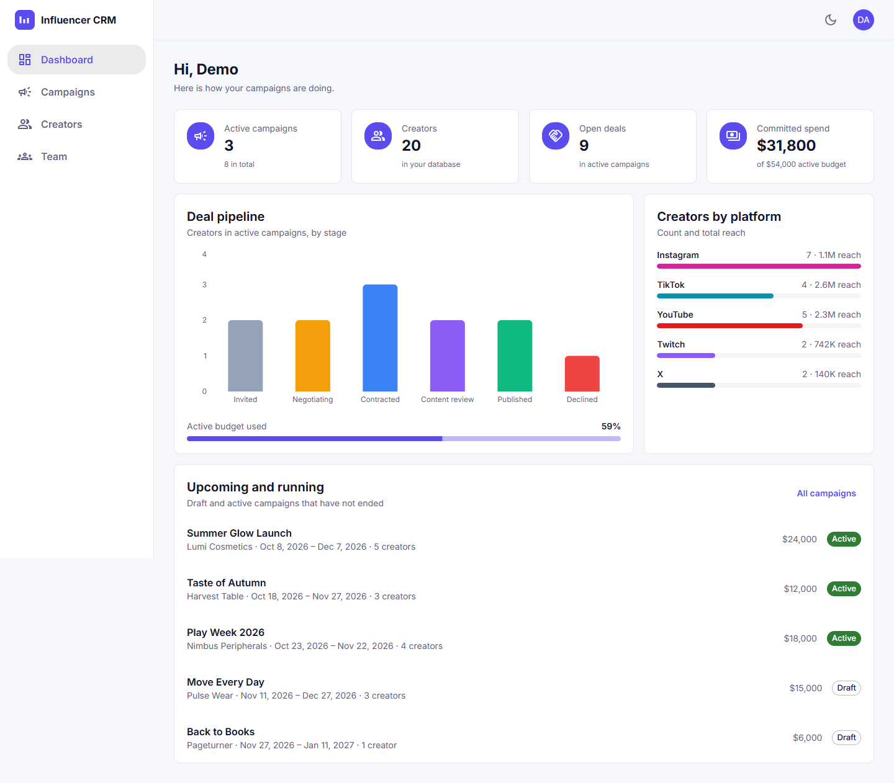
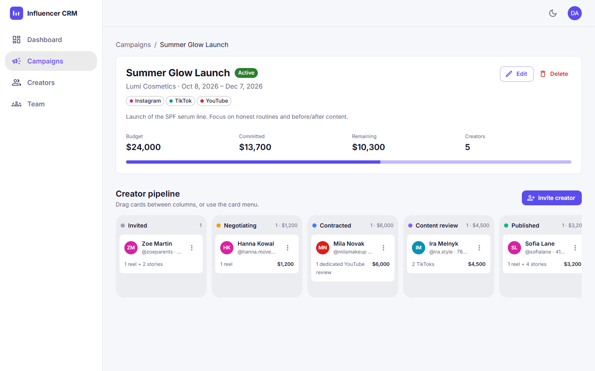
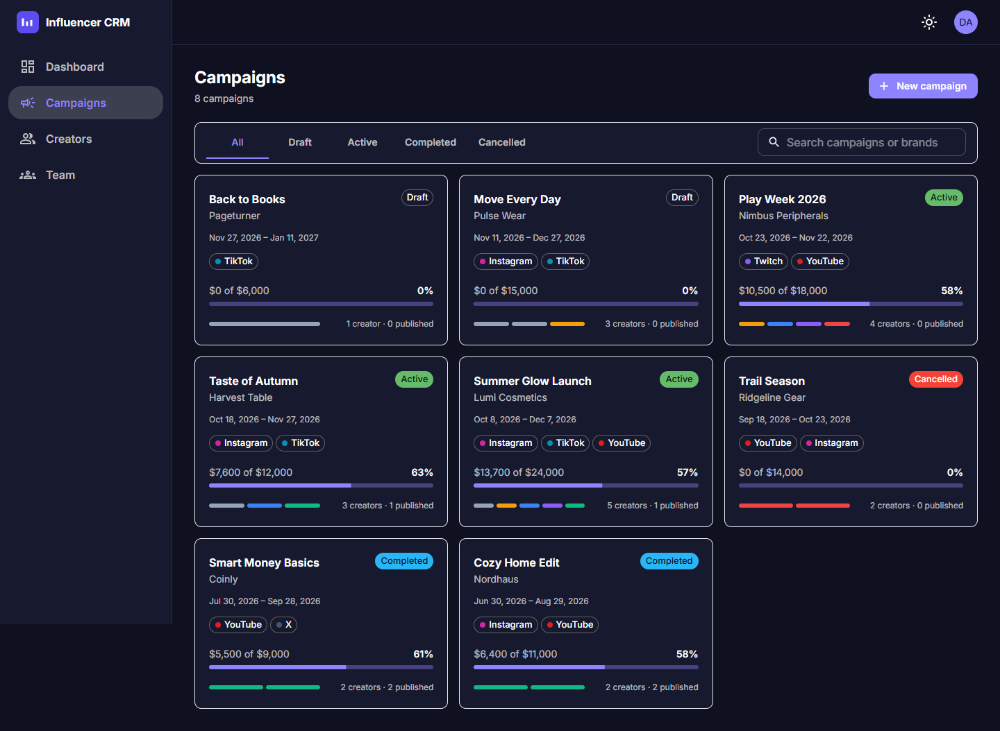
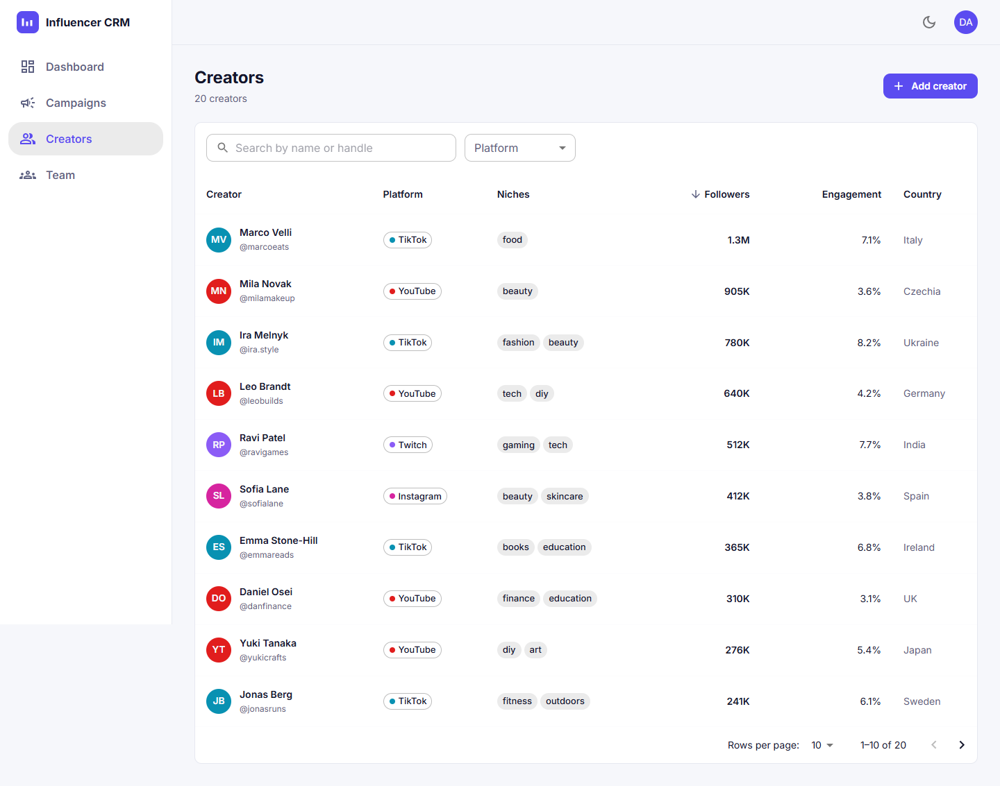
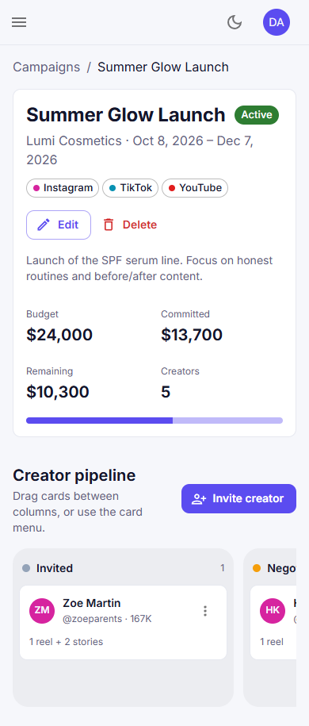

# Influencer CRM

A full-stack CRM for influencer marketing teams: keep a database of creators, plan campaigns with budgets, and move every creator deal through a pipeline from the first invite to the published post.

**Stack:** MongoDB · Express 5 · React 19 · Node.js, all in TypeScript.



## Features

- **Auth that holds up in an interview:** short-lived JWT access tokens kept in memory, refresh tokens in an `httpOnly`, `SameSite=Strict` cookie, **refresh token rotation with reuse detection** (a stolen token that is used twice revokes every session of that user), bcrypt hashing, login rate limiting, and roles (admin / manager).
- **Creators:** search, platform filter, sortable columns and server-side pagination, all mirrored in the URL so a filtered view can be shared.
- **Campaigns:** budget, dates, platforms and status, plus a **kanban deal pipeline** (Invited → Negotiating → Contracted → Content review → Published / Declined). Cards are moved by drag and drop or from a menu (works on touch screens), with **optimistic updates** that roll back if the request fails.
- **Dashboard:** numbers computed with **MongoDB aggregation pipelines**: deals per stage, committed spend versus budget, reach per platform.
- **API docs:** OpenAPI 3.1 at `/api/docs`, **generated from the same Zod schemas** that validate requests, so the docs cannot drift from the code.
- Light and dark themes, responsive down to phone width, code-split routes.

| Campaign pipeline | Campaigns (dark theme) |
| --- | --- |
|  |  |

| Creators | Mobile |
| --- | --- |
|  |  |

## Quick start

Requires Node.js 22. No MongoDB install needed: without `MONGODB_URI`, development starts an in-memory database and fills it with demo data.

```bash
npm install
cp server/.env.example server/.env
npm run dev
```

- App: http://localhost:5173. Use **Try the demo account** (`demo@influencer-crm.dev` / `demo12345`).
- API docs: http://localhost:4000/api/docs

Production-like run with a real MongoDB in Docker:

```bash
docker compose up --build    # http://localhost:4000
```

## Scripts

| Command | What it does |
| --- | --- |
| `npm run dev` | API (tsx watch) and client (Vite) together |
| `npm test` | API tests (Vitest + Supertest + in-memory MongoDB) and client tests (Testing Library) |
| `npm run lint` / `npm run typecheck` | ESLint and TypeScript for both apps |
| `npm run build` | Bundles the client and compiles the API |
| `npm start` | Runs the compiled API, which also serves the built client |
| `npm run seed` | Fills an empty database with demo data (`-- --reset` wipes it first) |

## Architecture

```
client/  React 19, Redux Toolkit + RTK Query, React Router 7, MUI, React Hook Form + Zod
  src/api/          RTK Query slice: re-auth on 401, cache tags, optimistic updates
  src/app/          store, auth slice, theme
  src/features/     auth, dashboard, creators, campaigns, team (one folder per page area)
  src/components/   layout and shared UI

server/  Express 5, Mongoose 9, Zod 4
  src/modules/      auth, users, creators, campaigns, stats: routes + schemas + models per module
  src/middleware/   requireAuth / requireRole, validateBody, notFound, central errorHandler
  src/docs/         OpenAPI spec generated from the Zod schemas
  src/db/           connection (in-memory fallback in development) and demo seed
  tests/            API tests against a real (in-memory) MongoDB
```

**Single origin:** in production Express serves the built client, so the browser talks to one origin: no CORS preflights, and the refresh cookie can be `SameSite=Strict`, which also blocks CSRF. In development the Vite proxy gives the same setup.

**Some decisions worth discussing:**

- *Creator deals are embedded in the campaign document,* not a separate collection. A campaign and its deals are always read together, a campaign has tens of creators at most, and atomic array operators (`$push` guarded by `$ne`, positional `$set`) keep concurrent updates safe without transactions.
- *Refresh tokens are not stored, only their id (`jti`).* A database leak gives an attacker no usable tokens, and a TTL index lets MongoDB delete expired sessions by itself.
- *Login returns the same error and takes the same time* for an unknown email and a wrong password (a dummy bcrypt comparison), so it cannot be used to check which emails are registered.
- *One in-flight refresh on the client.* Several requests failing with 401 at once (or React StrictMode running an effect twice) share one refresh call; otherwise rotation would treat the second call as token reuse and log the user out.

## API

| Method | Path | Notes |
| --- | --- | --- |
| POST | `/api/auth/register` · `/login` · `/refresh` · `/logout` | the first registered user becomes admin |
| GET | `/api/auth/me` | current user |
| GET, POST | `/api/creators` | `?q=&platform=&niche=&minFollowers=&sort=&page=&limit=` |
| GET, PATCH, DELETE | `/api/creators/:id` | delete is admin-only and blocked while the creator is in a campaign |
| GET, POST | `/api/campaigns` | `?q=&status=&sort=&page=&limit=` |
| GET, PATCH, DELETE | `/api/campaigns/:id` | |
| POST | `/api/campaigns/:id/creators` | invite a creator |
| PATCH, DELETE | `/api/campaigns/:id/creators/:creatorId` | move a deal through the pipeline, change the fee, or remove it |
| GET | `/api/stats/overview` | dashboard aggregations |
| GET, PATCH | `/api/users`, `/api/users/:id/role` | admin-only team management |

Full schemas are on the interactive docs at `/api/docs`.

## Deployment

`render.yaml` deploys the app as one Render web service. Create a free MongoDB Atlas cluster, set `MONGODB_URI`; the JWT secrets are generated automatically. `SEED_DEMO=true` fills the empty database with the demo account. CI (GitHub Actions) runs lint, type checks, all tests, the build and a Docker image build on every push.
